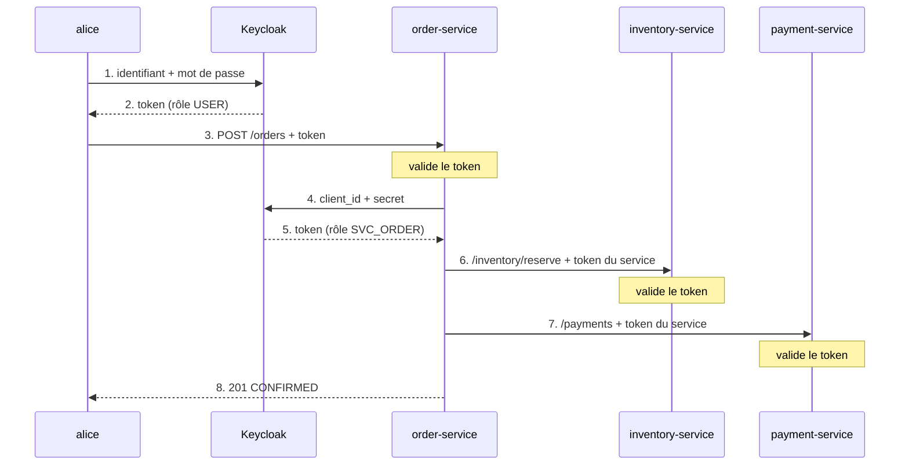

# Authentification et gestion des identités

Projet Ingénierie des Systèmes Sécurisés (ENSIAS 3A GL, A.U. 2026/2027), application `secure-orders` à 3 microservices.
État au 20/11/2026 : étapes A1 à A4 terminées (Keycloak, validation JWT, client credentials, rôle de service).

## Sommaire

1. [Mécanismes utilisés](#1-mécanismes-utilisés)
2. [Nuance pour le rapport](#2-nuance-pour-le-rapport)
3. [Flux d'une commande](#3-flux-dune-commande)
4. [Ce qui est en place (A1 à A4)](#4-ce-qui-est-en-place-a1-à-a4)
5. [Abréviations](#5-abréviations)
6. [Limites](#6-limites)
7. [Reste à faire](#7-reste-à-faire)

## 1. Mécanismes utilisés

Dans notre cas, nous utilisons **OAuth 2.0 / OIDC avec des jetons JWT**. Nous n'utilisons **pas** mTLS.

| Mécanisme | Utilisé ? | Comment (dans notre projet) | Rôle |
|---|---|---|---|
| **OAuth 2.0 / OIDC** | Oui | **Keycloak** est le serveur d'identité. Il délivre les tokens via deux flux : *password* (alice et bob, pour les tests) et *client credentials* (`order-service`, pour s'authentifier auprès des autres services). Chaque service lit la configuration OIDC de Keycloak via `issuer-uri` (découverte des clés de signature). | OAuth 2.0 définit **comment obtenir** un token. OIDC ajoute la couche d'identité et la découverte automatique. |
| **JWT** | Oui | Format des tokens émis par Keycloak. Les 3 services vérifient leur signature, leur expiration et leur émetteur. | Définit **à quoi ressemble** le token. |
| **mTLS** | Non | Bonus prévu (étape A5), pas encore fait. | Authentification mutuelle du client et du serveur par certificat. |

## 2. Nuance pour le rapport

Nous utilisons OAuth 2.0 pour obtenir les tokens d'accès, et OIDC seulement pour la découverte des clés (le *discovery document* de Keycloak). Nous n'utilisons ni l'ID token ni la connexion d'un utilisateur par navigateur.

Formulation exacte à employer :

> OAuth 2.0 avec Keycloak comme fournisseur OIDC, et JWT comme format de token.

## 3. Flux d'une commande

`order`, `inventory` et `payment` sont les trois microservices. Deux tokens sont en jeu : celui de l'utilisateur (étapes 1 à 3) et celui du service `order-service` (étapes 4 à 7).

Pourquoi `order-service` utilise son propre token plutôt que celui d'alice : les services appelés savent ainsi **quel service** les appelle (moindre privilège via le rôle `SVC_ORDER`), et un token utilisateur transmis de service en service pourrait être rejoué ailleurs avec tous les droits de l'utilisateur. Contrepartie : le service appelé ne voit plus l'utilisateur final.

## 4. Ce qui est en place (A1 à A4)

| Étape | Réalisation |
|---|---|
| **A1** Keycloak | Realm `secure-orders`. Rôles `USER`, `ADMIN`, `SVC_ORDER`. Utilisateurs `alice` (`USER`) et `bob` (`USER`, `ADMIN`). Clients `demo-client` (obtention de tokens de test) et `order-service` (client confidentiel avec compte de service). |
| **A2** Validation JWT | Les 3 services sont des *resource servers* : ils vérifient signature, expiration et émetteur via `issuer-uri`. `SecurityConfig` convertit `realm_access.roles` en autorités `ROLE_*`. Un appel sans token renvoie 401. |
| **A3** Client credentials | `order-service` obtient son propre token auprès de Keycloak et l'ajoute à ses appels vers `inventory-service` et `payment-service`. Le secret est lu depuis la variable d'environnement `ORDER_CLIENT_SECRET`, jamais depuis le dépôt. |
| **A4** Identité du service | Le rôle `SVC_ORDER` est assigné au compte de service de `order-service`. Son token contient `SVC_ORDER` et pas `USER`. |

Rappel : **401** = non authentifié (token absent ou invalide) ; **403** = authentifié mais non autorisé (produit par les règles d'autorisation de la personne B).

## 5. Abréviations

| Abréviation | Signification | Définition |
|---|---|---|
| **OAuth 2.0** | Open Authorization, version 2.0 | Cadre de délégation d'autorisation par tokens d'accès. |
| **OIDC** | OpenID Connect | Couche d'identité construite au-dessus d'OAuth 2.0. |
| **JWT** | JSON Web Token | Format de token signé (`en-tête.contenu.signature`). |
| **mTLS** | Mutual Transport Layer Security (TLS mutuel) | TLS où le client et le serveur s'authentifient tous les deux avec un certificat. |
| **TLS** | Transport Layer Security | Protocole de sécurisation des échanges réseau. |

## 6. Limites

À mentionner dans le rapport :

- le flux *password* de `demo-client` n'est utilisé que pour les tests ;
- Keycloak tourne en mode dev ;
- le secret est dans une variable d'environnement, pas dans un gestionnaire de secrets ;
- un token déjà émis reste valide jusqu'à son expiration (pas de révocation immédiate) ;
- le token de service ne porte pas l'identité de l'utilisateur final ;
- mTLS n'est pas encore mis en œuvre.

## 7. Reste à faire

- Merger la branche `feat/keycloak-jwt` dans `main`.
- Personne B (Aya) : règles d'autorisation RBAC puis ABAC, tests de sécurité (401, 403, token expiré).
- Rédaction du rapport, partie par partie.
- Bonus si le temps le permet : mTLS entre `order-service` et `inventory-service`, ou pipeline GitHub Actions.